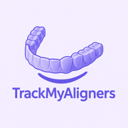
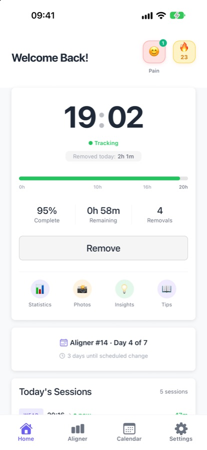
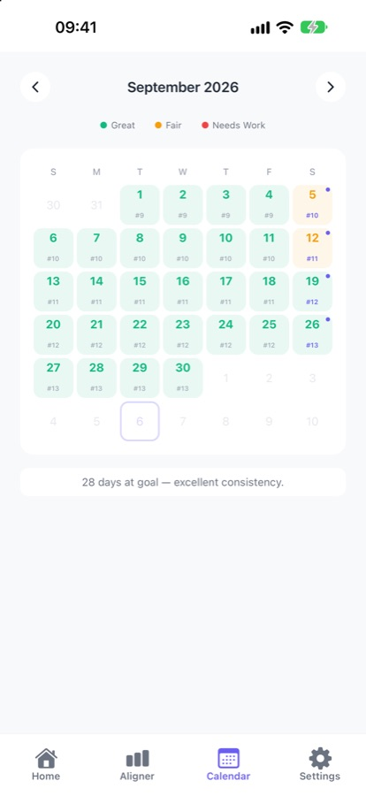
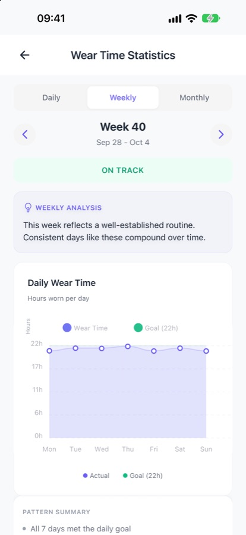
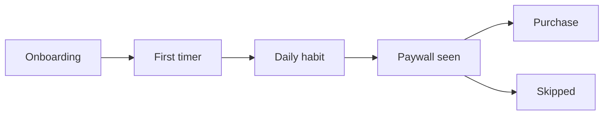

# TrackMyAligners

**Wear your aligners. We'll count the hours.**

A wear-time tracker for people in clear aligner treatment, on iPhone, in six languages.
I run it solo, from product decisions to analytics and marketing.

[App Store](https://apps.apple.com/us/app/aligner-trackmyaligners/id6755816888) · [Website](https://trackmyaligners-web.vercel.app)

| ⭐ 4.4 | 79 | 21 | 6 |
|:--:|:--:|:--:|:--:|
| average App Store rating | ratings | countries with ratings | languages |

Public App Store ratings, counted across storefronts on October 31, 2026.

> The code is private. This page is the product story: the problem, the decisions and how I measure them.

<table>
  <tr>
    <td></td>
    <td></td>
    <td></td>
  </tr>
</table>

## The problem

People in clear aligner treatment are told to wear their trays 20–22 hours a day. Then real life happens: they take the trays out for lunch, coffee and "just five minutes".

So they guess their wear time, and the guess is usually too generous. They also lose track of which tray they're on and when the next change is due.

They want three things: finish on time, see proof of progress, and feel in control without effort.

## The product

Tap when the aligners come out and tap again when they go back in. The app handles the rest: today's wear time, tray schedule, reminders, streaks, a pain log for check-ups and progress photos.

It's a tracking tool. It does not straighten teeth, and my own marketing brief says so in writing, in case I get excited.

## The business model

| | Free | Pro (subscription) |
|---|---|---|
| **Job** | Everything needed day to day | Understanding your habits over time |
| **Includes** | Timer, tray schedule, reminders, calendar, streaks, pain log | Weekly and monthly insights, per-aligner performance, unlimited photos |
| **Revenue** | Ads, including a video that unlocks daily statistics | App Store subscription, no ads |

The principle is **free to track, Pro to go deeper**. People who only need the timer shouldn't have to pay, and people who want to know why their weekends keep slipping can.

## Decisions I made, and why

### 1. Onboarding went from 12 screens to 8

My design doc says it plainly: *"No hard analytics drove this. It was a gut-feel that onboarding was off."*

That's an uncomfortable sentence for a business analyst to write, so the same period produced the analytics plan below. The redesign targeted a run of five consecutive data-entry screens, and every remaining question had to pass one test: does this answer map to a reward, a notification or attribution? If not, I don't ask it.

### 2. The paywall became less pushy and better timed

- The onboarding paywall can be skipped, with a visible way out.
- It shows again at moments of value, not at random.
- Users get one real insight free, with the rest listed as locked.
- Daily statistics stay free, while weekly and monthly views lead to Pro.
- Trial labels are honest, and events record which placement and plan each view came from, so placements can be compared.

### 3. Privacy was treated as a product decision

Syncing treatment data was what my strategy doc calls a **privacy one-way door**, so it was scoped on purpose instead of drifting in.

- Treatment data lives on the phone, and backup is optional.
- Progress photos are never uploaded.
- Ad measurement starts only after consent.
- Accounts and their data can be deleted in the app.

One commit message I like on this project is *"stop calling analytics anonymous"*. The copy sounded nicer before, but it wasn't accurate enough, so it went.

### 4. Work was sequenced by return per hour

Three data projects looked similar and were not:

| Project | For whom | Risk | Decision |
|---|---|---|---|
| Product analytics | Me | Low | **Do now.** Free, and it unblocks measuring everything else |
| Login and cloud backup | The user | High (privacy) | **Next, deliberately.** Now shipped as optional backup |
| Cohort benchmarks | The user | High, and needs scale | **Later.** Depends on the other two |

All three could start at $0, so money wasn't the constraint. Time was.

## How I measure it

| Question | Where I look |
|---|---|
| Where do new users quit? | Step-by-step onboarding events |
| Did they reach the first real use? | `timer_started` after onboarding |
| Is it becoming a habit? | Wear sessions, goals and streaks over time |
| Which paywall moment works? | `paywall_viewed` by placement, through to purchase |
| Why do purchases fail? | The failure reason is recorded on `purchase_failed` |
| Is the video unlock worth having? | `stats_unlock_shown` → `started` → `completed` |

The original plan was about 16 events, with the rule *"If we won't look at it, don't send it."*
There are now nearly 40. Looking at all of them has become part of the job.

**Where are the rest of the numbers?** Funnel figures stay in a private dashboard. The public ones are at the top of this page, and they're real, because my brief bans invented numbers. I checked. I was hoping for a loophole.

## Getting it in front of people

- **Search:** 19 guides on real aligner questions, such as how long aligners can be out, plus site files for search engines and AI assistants.
- **Orthodontists:** landing pages in English and Turkish, plus printable QR cards that use a separate campaign link per practice, so downloads can be attributed.
- **Outreach rules, written first:** one email and at most one follow-up, no attachments in the first email, and a real opt-out in every message.
- **Short video:** a faceless TikTok plan with 20 carousel concepts and three content pillars.
- **Six languages:** English, Turkish, German, Spanish, Italian and Arabic, including full right-to-left.

## Things I said no to

- ❌ "Straightens your teeth faster"
- ❌ "100% private", because optional backup and consented analytics exist
- ❌ Fake reviews, invented download counts or "doctor recommended" badges
- ❌ Before/after photos presented as real users' results

Saying no to these is much easier when the rule was written before the launch was close.

## What I took from it

1. A gut feeling is a fine place to start and a bad place to stop.
2. Honest copy is a product decision, not a legal chore.
3. The person with the most opinions about your funnel should also be the one instrumenting it. In my case that was easy to arrange.

---

*TrackMyAligners is a tracking tool, not a medical device, and does not give medical advice. Always follow your orthodontist's instructions. Invisalign, ClearCorrect and Spark are trademarks of their respective owners.*

*Back to [my profile](https://github.com/yuceugur).*
